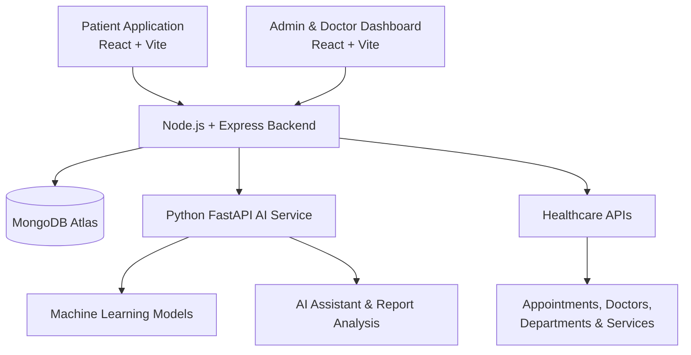

# Medicare — Healthcare Management Platform

Medicare is a full-stack healthcare management platform designed to simplify interactions between patients, doctors, and administrators. It brings appointment management, medical report analysis, AI-powered health assistance, and patient health tracking together in one platform.

The project consists of three main application layers: a patient-facing web application, an admin and doctor dashboard, and a backend supported by an AI service.

## 🌐 Live Applications

| Application | Link |
|---|---|
| Patient Application | [Open Medicare Patient App](https://medicare-xi-taupe.vercel.app/) |
| Admin & Doctor Dashboard | [Open Medicare Admin App](https://medicare-yv1z.vercel.app/) |
| GitHub Repository | [View Source Code](https://github.com/srashti0709/Medicare) |

## 🔐 Demo Login Credentials

Use the following credentials to explore the Admin and Doctor dashboards.

### Admin Account

| Field | Credentials |
|---|---|
| Email | `admin@medicare.com` |
| Password | `Admin@123456` |
| Access | Admin Dashboard |

### Doctor Account

| Field | Credentials |
|---|---|
| Email | `rahul@medicare.com` |
| Password | `Doctor@123` |
| Access | Doctor Dashboard |

**Patient Account:** New users can create their own accounts directly through the Patient Application using the registration page.

> **Demo account notice:** These credentials are provided for demonstration purposes. Please use only dedicated demo accounts and synthetic data. Never enter real patient information into a publicly accessible demo environment.

## ✨ Key Features

### 👤 Patient Application

- **User Registration & Authentication:** Patients can create accounts and securely log in.
- **Doctor Discovery:** Browse available doctors and view their profiles and details.
- **Appointment Booking:** Book appointments with doctors and manage existing appointments.
- **Appointment Tracking:** View appointment details and monitor appointment status.
- **Health Report Analyzer:** Upload medical reports for AI-assisted analysis.
- **AI Health Assistant:** Interact with an AI-powered assistant for health-related guidance.
- **Health Timeline:** Access a consolidated view of health-related information and history.
- **Report Comparison:** Compare health reports to understand changes across different reports.

### 🩺 Doctor Dashboard

- **Doctor Dashboard:** Access doctor-specific dashboard functionality.
- **Appointment Management:** View and manage assigned patient appointments.
- **Patient Information:** Access eligible patient information based on appointment authorization.
- **Pre-consultation Support:** Review patient information and relevant health context before consultations.
- **Doctor Profile & Schedule:** Manage profile details and availability.
- **AI-powered Health Tools:** Access supported diabetes and kidney disease risk assessment features.

### 🛡️ Admin Dashboard

- **Dashboard Overview:** Monitor platform activity and healthcare management information.
- **Doctor Management:** Add, update, and manage doctor profiles.
- **Department Management:** Organize and manage healthcare departments.
- **Service Management:** Manage the healthcare services available on the platform.
- **Appointment Management:** View and manage appointments.
- **Doctor Schedule Management:** Manage doctor availability and schedules.
- **Role-based Access:** Separate administrative functionality from doctor and patient functionality.

### 🤖 AI & Healthcare Intelligence

- AI-assisted medical report analysis.
- Diabetes risk assessment using machine learning.
- Kidney disease risk assessment using machine learning.
- AI-powered healthcare assistant.
- Patient health history and timeline functionality.

**Note:** AI-generated information is intended to support healthcare understanding and workflows. It is not a substitute for professional medical diagnosis or treatment.

## 🧰 Technology Stack

| Layer | Technologies |
|---|---|
| Patient Frontend | React 19, Vite, Tailwind CSS 4 |
| Admin Frontend | React 19, Vite, Tailwind CSS 4 |
| Backend | Node.js, Express.js |
| Database | MongoDB Atlas, Mongoose |
| Authentication | JWT, bcryptjs |
| API Communication | Axios, REST APIs |
| Validation | Joi |
| Data Visualization | Recharts |
| AI Backend | Python, FastAPI |
| Machine Learning | Scikit-learn, XGBoost, Pandas, NumPy |
| AI Integration | OpenAI SDK |
| Deployment | Vercel (Frontend Applications) |

## 🏗️ Project Architecture



## 📁 Project Structure

```text
Medicare/
│
├── admin-app/
│   ├── src/
│   ├── public/
│   └── package.json
│
├── user-app/
│   ├── src/
│   ├── public/
│   └── package.json
│
├── backend/
│   ├── src/
│   │   ├── config/
│   │   ├── controllers/
│   │   ├── middleware/
│   │   ├── models/
│   │   ├── routes/
│   │   └── services/
│   ├── uploads/
│   └── package.json
│
├── ai-service/
│   ├── main.py
│   ├── requirements.txt
│   └── ...
│
└── .gitignore
```

## ⚙️ Local Installation & Setup

### Prerequisites

Make sure you have the following installed:

- Node.js and npm
- Python 3.10 or a compatible version for the AI service dependencies
- MongoDB Atlas account
- Git

### 1. Clone the Repository

```bash
git clone https://github.com/srashti0709/Medicare.git
cd Medicare
```

### 2. Configure the Backend

Open a terminal:

```bash
cd backend
npm install
```

Create a `.env` file inside the `backend` directory and configure your environment:

```env
PORT=5000
MONGO_URI=your_mongodb_atlas_connection_string
FRONTEND_URLS=http://localhost:5173,http://localhost:5174
```

Add any other environment variables required by your backend configuration. Never commit your `.env` file.

Start the backend:

```bash
npm run dev
```

The backend runs at:

```text
http://localhost:5000
```

### 3. Configure the Patient Application

Open another terminal:

```bash
cd user-app
npm install
```

Create a `.env` file:

```env
VITE_API_URL=http://localhost:5000
```

Start the application:

```bash
npm run dev
```

The patient application runs at:

```text
http://localhost:5173
```

### 4. Configure the Admin Application

Open another terminal:

```bash
cd admin-app
npm install
```

Create a `.env` file:

```env
VITE_API_URL=http://localhost:5000
```

Start the application:

```bash
npm run dev
```

The admin application runs at:

```text
http://localhost:5174
```

### 5. Configure the AI Service

Open another terminal:

```bash
cd ai-service
```

Create and activate a Python virtual environment:

```bash
python -m venv venv
```

For Windows CMD:

```bash
venv\Scripts\activate
```

Install dependencies:

```bash
pip install -r requirements.txt
```

Configure the AI service's required environment variables and start it using the application's FastAPI/Uvicorn configuration.

## 🔒 Security & Access Control

Medicare incorporates several security measures:

- JWT-based authentication.
- Password hashing using bcryptjs.
- Role-based access control for patients, doctors, and administrators.
- Protected API routes.
- Request validation using Joi.
- File upload restrictions for medical report uploads.
- Patient-specific access controls for protected healthcare information.

Sensitive configuration values, database credentials, API keys, and production passwords should always be stored in environment variables and excluded from version control.

## 🚀 Future Enhancements

- Expand the patient health timeline with richer longitudinal health insights.
- Improve report comparison and historical health visualizations.
- Enhance doctor pre-consultation summaries.
- Expand automated testing and continuous integration.
- Improve API documentation and deployment workflows.

## 👩‍💻 Developer

**Developed by Srashti Shakya**

BCA Final-Year Student | Full-Stack Development | AI & Machine Learning

GitHub: [@srashti0709](https://github.com/srashti0709)

---

⭐ If you find this project interesting, consider giving the repository a star!
